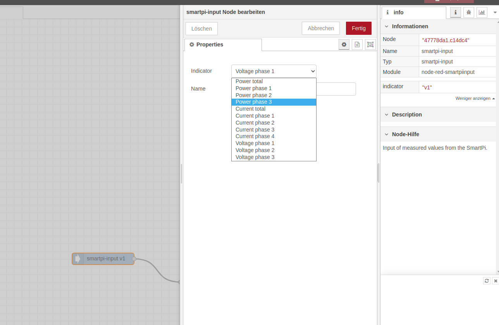
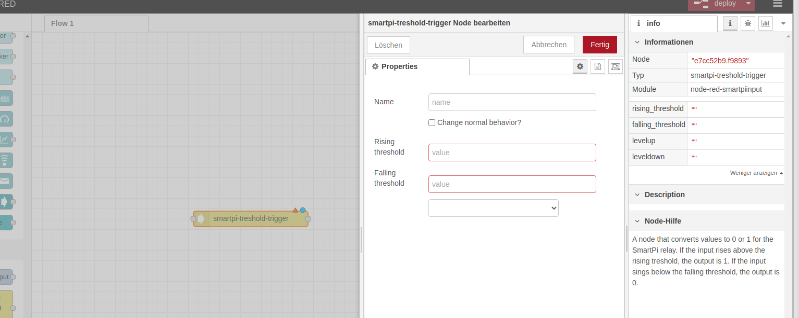

# @nd-enerserve/node-red-smartpi
## Install

To install the stable version use the `Menu - Manage palette` option and search for `node-red-smartpi`, or run the following command in your Node-RED user directory - typically `~/.node-red`:

    npm i @nd-enerserve/node-red-smartpi

Execution environment of this node is Node-RED v1.0 or later.

## Usage
Use the smartpi-input module to read out and evaluate the measured values of the SmartPi.

The value to be used can be set in the settings. The measured values are output at one second intervals.

The smartpi-treshold-trigger can convert the measured values of the smartpi-input node into logical values. For this purpose, it is specified in the settings of the node from which value (exceeding) the node outputs a 1 (rising threshold) and from which value (falling below) the node outputs a 0 again (falling threshold).
By specifying different values for the rising threshold and falling threshold, hysteresis is possible.

### Output modules
- **analog out 4-20mA** (`smartpi-e.analog-out`): sets the 4-20mA output of an MCP4725 module, `msg.payload` in mA.
- **analog out 0-10V** (`smartpi-e.analog-out-010v`): sets the four 0-10V outputs of an MCP4728 module. A Node-RED node has only one input, so `msg.topic` (1-4, numbered on the board from left to right) selects the output and `msg.payload` is the voltage (0-10 V); only that output is written. Wire several sources with different topics into one node. Alternatively a fixed output or "all" (array payload) can be configured.

Both modules default to I2C address 0x60 - if both are on the same bus, one of them needs a different address.
